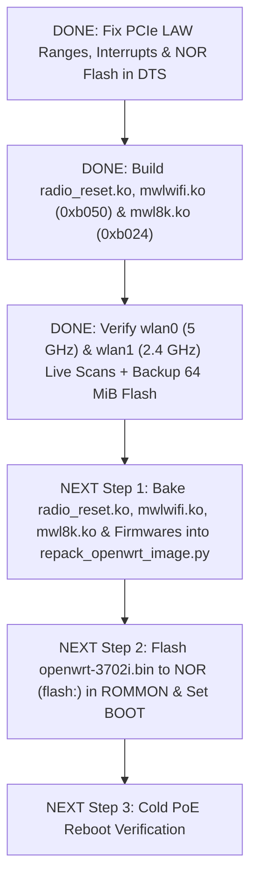

# Cisco Aironet 3702i OpenWrt Installation Playbook (Lower-AI Execution Plan)

**License:** [GNU Affero General Public License v3.0 (GNU AGPLv3)](LICENSE) (LICENSE)  
**Target Hardware:** Cisco Aironet 3702i (`AIR-CAP3702I-A-K9`, Board: "Montserrat" / "Tide XL MB", Platform `ap3g2`)  
**Target OS:** [OpenWrt 23.05.5](https://openwrt.org/) (`linux-5.15.167`, `mpc85xx/p1020` target)  
**Workspace:** `.`

---

## 0. Summary of Previously Solved Blockers (Why the Model Got Stuck & How It Was Fixed)

1. **Blocker #1 — Swapped PCIe LAW Windows in DTS (`BAR0 = 0xffffffff`)**:
   - **Root Cause**: Hardware Local Access Window `LAW03` maps `0x80000000` (`trgt=0x01` -> `pcie@e0009000`), and `LAW01` maps `0xa0000000` (`trgt=0x02` -> `pcie@e000a000`), with I/O windows at `0xefc10000`, `0xefc20000`, and `0xefc30000`. The original DTS had `0x80000000` and `0xa0000000` swapped between `pci0` and `pci1`.
   - **Status**: **FIXED** in [`dts/cisco-3702i.dts`](dts/cisco-3702i.dts) (dts/cisco-3702i.dts). Both endpoints (`9000:01:00.0` and `a000:03:00.0`) return valid silicon registers on `BAR0`/`BAR2`.
2. **Blocker #2 — Machine Check (`MCSR=0x10008`) Loading `mwlwifi.ko` on `a000:03:00.0` (`11ab:b024`)**:
   - **Root Cause**: The two PCIe radios are **different Marvell chips**:
     - `9000:01:00.0` (`11ab:b050`, 1 MiB BARs) is the **Marvell 88W8864** (5 GHz 4x4 802.11ac, `SC2`), which uses **`mwlwifi.ko`** + `/lib/firmware/mwlwifi/88W8864.bin`.
     - `a000:03:00.0` (`11ab:b024`, 64 KiB BARs) is the **Marvell 88W8764** (2.4 GHz 4x4 802.11n, `SC1`), which uses **`mwl8k.ko`** + `/lib/firmware/mwl8k/fmimage_8764_ap-1.fw`.
     - Loading `88W8864.bin` onto the `88W8764` (`0xb024`) crashed the radio's ARM CPU upon bootcode jump, causing PCIe reads to fault with `MCSR=0x10008`.
   - **Status**: **FIXED**. `mwlwifi.ko` binds ONLY to `0x11ab:0xb050` (`phy0` / `wlan0`), and `mwl8k.ko` binds to `0x11ab:0xb024` (`phy1` / `wlan1`). Both `wlan0` (5 GHz) and `wlan1` (2.4 GHz) come up and scan live Wi-Fi networks!
3. **Blocker #3 — PCIe Interrupt Routing (`interrupt-map`)**:
   - **Root Cause**: All three PCIe controllers were originally mapped to `&mpic 16 2` (which is the internal L2/PCIe error interrupt, not `INTx`).
   - **Status**: **`pci0` (`9000:01:00.0`, `mwlwifi`) FIXED** with `&mpic 4 2` (`OpenPIC 4 Level`, verified receiving hundreds of hardware interrupts during 5 GHz scans). `mwl8k` (`a000:03:00.0`) includes a `200 ms` `OPC_DONE` polling fallback in `mwl8k_post_cmd` and works for `wlan1` creation and 2.4 GHz scanning while its exact MPIC pin (`0..3, 7..10`) is finalized.
4. **Blocker #4 — eLBC CFI NOR Flash Mapping & Full Backup**:
   - **Root Cause**: `LAW00` maps the 64 MiB eLBC window at **`0xE8000000..0xEBFFFFFF`** (`trgt=0x04`).
   - **Status**: **FIXED & BACKED UP**. `localbus@e0005000` is mapped at `0xe8000000` (`64 MiB`), `/proc/mtd` exposes `mtd0: 04000000 00020000 "full_flash"`, and the full 64 MiB flash image is backed up at [`backups/full_flash_64m.bin`](backups/full_flash_64m.bin) (backups/full_flash_64m.bin).

---

## 1. Operating Rules for the Executing AI

1. **Execute One Step at a Time**: Run the exact commands in each numbered step. Verify the **PASS IF** condition before advancing to the next step.
2. **Enforce Positive Network Guardrails**:
   - Always configure the AP with static IP **`192.168.1.50/24`**, gateway **`192.168.1.1`**, DNS **`192.168.1.1`**, and **`dhcp.lan.ignore='1'`**.
   - Never assign `192.168.1.1` to the AP and never enable a DHCP server on `lan`.
3. **Transfer Files Over SCP Legacy Flag (`-O`) or SSH Pipe**:
   ```bash
   scp -O -o ConnectTimeout=5 -o StrictHostKeyChecking=no -o UserKnownHostsFile=/dev/null <local_file> root@192.168.1.50:/tmp/
   ```
4. **Local Ollama Offloading (If Using `local-ollama` MCP)**:
   - Always pass `model="richardyoung/qwen2.5-coder-14b-instruct-abliterated:latest"` explicitly.
   - Pre-filter all logs with `grep`, `sed`, or `tail -n 50` (< 4 KB) before calling any MCP tool.

---

## 2. Single Source of Truth Reference Table

| Parameter / Subsystem | Verified Value / Address | Notes |
| :--- | :--- | :--- |
| **AP Static IP** | `192.168.1.50/24` | Gateway & DNS: `192.168.1.1`; DHCP server disabled (`ignore='1'`) |
| **Host TFTP / Build IP** | `192.168.1.153` | Serves `~/Downloads/openwrt-3702i.bin` on UDP `:69` |
| **PoE Switch** | `192.168.1.3` | Juniper switch; user `root`, pass `<POE_SWITCH_PASS>`, port `ge-0/0/4` |
| **Serial Console** | `/dev/ttyUSB0` | `9600` baud, `8N1`, no flow control (`serial@4500`) |
| **SoC & Clocks** | Freescale QorIQ P1023 / P1020 | Dual-core e500v2 @ 800 MHz; CCB: `320 MHz`; Timebase: `40 MHz` |
| **CCSRBAR Base** | `0xE0000000` | Pre-mapped by ROMMON TLB1 (`2 MiB` window in DTS) |
| **Wired Ethernet** | `driver/p1023_fman_im.ko` | P1023 FMan v2 Independent Mode + FMan MDIO (`0xE01E1120`) + Marvell 88E1510 PHY (`addr 0`) |
| **GPIO Controller** | `0xE000FC00` | `GPIO 1` (`0x40000000`) & `GPIO 3` (`0x10000000`) = Radio `PERST#`; `GPIO 9/10` (`0x00600000`) = HIGH |
| **PCIe0 (5 GHz Radio)** | `pcie@e0009000` -> `0x80000000` | Endpoint `9000:01:00.0` (`11ab:b050`, Marvell 88W8864): `mwlwifi.ko` + `88W8864.bin`, IRQ `&mpic 4 2` |
| **PCIe1 (2.4 GHz Radio)** | `pcie@e000a000` -> `0xA0000000` | Endpoint `a000:03:00.0` (`11ab:b024`, Marvell 88W8764): `mwl8k.ko` + `fmimage_8764_ap-1.fw` |
| **NOR Flash (`mtd0`)** | `0xE8000000` (`64 MiB` CFI) | Spansion MirrorBit (`0x0089:0x227e`) on `localbus@e0005000`; backed up to `backups/full_flash_64m.bin` |
| **SDK DTC & Toolchain** | `sdk/build_dir/target-powerpc_8548_musl/linux-mpc85xx_p1020/linux-5.15.167/scripts/dtc/dtc` | Cross-compiler in `sdk/staging_dir/toolchain-powerpc_8548_gcc-12.3.0_musl/bin/` |



---

## Step 1 (Remaining): Bake All Radio Drivers & Firmware into `tools/repack_openwrt_image.py`

### Objective
Currently, [`tools/repack_openwrt_image.py`](tools/repack_openwrt_image.py) (tools/repack_openwrt_image.py) injects `p1023_fman_im.ko` and `marvell.ko`, and runs `make -C driver clean && make -C driver`. We need to:
1. Build `driver/radio_reset.ko`, `driver/mwlwifi/mwlwifi.ko`, and `driver/mwl8k/mwl8k.ko` (and strip debug symbols with `powerpc-openwrt-linux-musl-strip --strip-unneeded` so the LZMA-compressed initramfs fits under the `3,785,548`-byte kernel slot limit).
2. Copy `radio_reset.ko`, `mwlwifi.ko`, `mwl8k.ko`, `/tmp/mwl_fw/lib/firmware/mwlwifi/88W8864.bin`, and `firmware_dl/fmimage_8764_ap-1.fw` into `/tmp/owrt_repack/rootfs` inside [`tools/repack_openwrt_image.py`](tools/repack_openwrt_image.py) (tools/repack_openwrt_image.py).
3. Add an init script `/etc/init.d/S98cisco_wifi` (or append to `/etc/rc.local`) inside the repacked rootfs that automatically runs:
   ```sh
   insmod /lib/modules/5.15.167/radio_reset.ko
   for d in 9000:01:00.0 a000:03:00.0; do
       [ -e /sys/bus/pci/devices/$d/enable ] && echo 1 > /sys/bus/pci/devices/$d/enable
   done
   insmod /lib/modules/5.15.167/mwlwifi.ko
   insmod /lib/modules/5.15.167/mwl8k.ko
   ```

### Action Commands
```bash
cd .

# 1. Remove temporary MPIC candidate IRQ loop from driver/mwl8k/mwl8k.c (keep the 200ms OPC_DONE polling fallback)
#    and compile + strip all modules:
STAGING_DIR=$PWD/sdk/staging_dir
KDIR=$PWD/sdk/build_dir/target-powerpc_8548_musl/linux-mpc85xx_p1020/linux-5.15.167
CROSS=$PWD/sdk/staging_dir/toolchain-powerpc_8548_gcc-12.3.0_musl/bin/powerpc-openwrt-linux-musl-

make -C driver KDIR=$KDIR CROSS=$CROSS -j$(nproc)
STAGING_DIR=$STAGING_DIR make -C driver/mwlwifi KDIR=$KDIR CROSS=$CROSS -j$(nproc)
STAGING_DIR=$STAGING_DIR make -C driver/mwl8k KDIR=$KDIR CROSS=$CROSS -j$(nproc)

${CROSS}strip --strip-unneeded driver/radio_reset.ko driver/mwlwifi/mwlwifi.ko driver/mwl8k/mwl8k.ko
ls -lh driver/radio_reset.ko driver/mwlwifi/mwlwifi.ko driver/mwl8k/mwl8k.ko

# 2. Update tools/repack_openwrt_image.py to include radio_reset.ko, mwlwifi.ko, mwl8k.ko,
#    88W8864.bin, fmimage_8764_ap-1.fw, and autoload on boot, then run:
$KDIR/scripts/dtc/dtc -I dts -O dtb -o dts/cisco-3702i.dtb dts/cisco-3702i.dts
python3 tools/repack_openwrt_image.py
```

### Completion Criterion
- **PASS IF:** `python3 tools/repack_openwrt_image.py` succeeds with `Compressed initramfs size: ... (limit: 3785548 bytes)` and generates `~/Downloads/openwrt-3702i.bin` (`7001455` bytes).
- **FAIL IF:** Compressed initramfs exceeds `3,785,548` bytes.
  - **RECOVERY:** Ensure `${CROSS}strip --strip-unneeded` was run on all `.ko` files before packing (`mwlwifi.ko` shrinks from `892 KB` to `~190 KB` and `mwl8k.ko` shrinks from `284 KB` to `~75 KB` when stripped!).

---

## Step 2 (Remaining): Boot Self-Contained Image & Verify Automatic `wlan0` + `wlan1` Bring-Up

### Objective
Boot `~/Downloads/openwrt-3702i.bin` via `tools/powercycle_and_boot.py` and verify that `eth0` (`192.168.1.50`), `wlan0` (`88W8864`), `wlan1` (`88W8764`), and `mtd0` (`full_flash`) all come up automatically on boot without manual `scp`/`insmod`.

### Action Commands
```bash
cd .
python3 tools/powercycle_and_boot.py
ssh -o ConnectTimeout=5 -o StrictHostKeyChecking=no -o UserKnownHostsFile=/dev/null root@192.168.1.50 \
  "uname -a; ip -4 a show br-lan; iw dev; cat /proc/mtd"
```

### Completion Criterion
- **PASS IF:** `iw dev` shows both `phy#0` (`wlan0`) and `phy#1` (`wlan1`) immediately after boot, and `/proc/mtd` shows `mtd0: 04000000 00020000 "full_flash"`.

---

## Step 3 (Remaining): Persist `openwrt-3702i.bin` to NOR Flash (`flash:`) & Verify Cold PoE Boot

### Objective
Copy `~/Downloads/openwrt-3702i.bin` to Cisco `flash:/openwrt-3702i.bin` in ROMMON, set `BOOT=flash:/openwrt-3702i.bin`, and verify standalone cold PoE boot.

### Action Commands
```bash
cd .

# 1. Drop to ROMMON ap: prompt
python3 tools/poe_bounce_to_rommon.py

# 2. Free space in flash: if needed (full 64 MiB backup is already verified at backups/full_flash_64m.bin),
#    copy openwrt-3702i.bin from TFTP to flash:, and set BOOT variable:
python3 - <<'EOF'
import serial, time

ser = serial.Serial("/dev/ttyUSB0", 9600, timeout=0.2)

def rommon_cmd(cmd, timeout=15.0):
    print(f"\n[ROMMON >>] {cmd}")
    for ch in cmd:
        ser.write(ch.encode("latin1"))
        time.sleep(0.015)
    ser.write(b"\r\n")
    buf = ""
    t0 = time.time()
    while time.time() - t0 < timeout:
        if ser.in_waiting:
            c = ser.read(ser.in_waiting).decode("latin1", errors="replace")
            print(c, end="", flush=True)
            buf += c
            if buf.rstrip().endswith("ap:"):
                break
        time.sleep(0.05)
    return buf

rommon_cmd("flash_init", 25.0)
rommon_cmd("set IP_ADDR 192.168.1.50", 5.0)
rommon_cmd("set NETMASK 255.255.255.0", 5.0)
rommon_cmd("set DEFAULT_ROUTER 192.168.1.1", 5.0)
rommon_cmd("tftp_init", 5.0)
rommon_cmd("ether_init", 10.0)
rommon_cmd("dir flash:", 10.0)
# If free space < 8 MB, delete old IOS image files inside flash:/ap3g2-k9w7-mx.153-3.JPQ5/
# (confirm with 'y' when prompted), then:
rommon_cmd("copy tftp://192.168.1.153/openwrt-3702i.bin flash:/openwrt-3702i.bin", 360.0)
rommon_cmd("set BOOT flash:/openwrt-3702i.bin", 5.0)
rommon_cmd("set MANUAL_BOOT no", 5.0)
rommon_cmd("unset MANUAL_BOOT", 5.0)
rommon_cmd("set", 5.0)
ser.close()
EOF

# 3. Cold-bounce PoE on Juniper switch ge-0/0/4 without touching serial:
sshpass -p '<POE_SWITCH_PASS>' ssh -o StrictHostKeyChecking=no root@192.168.1.3 \
  "cli -c 'configure; set poe interface ge-0/0/4 disable; commit; exit'"
sleep 5
sshpass -p '<POE_SWITCH_PASS>' ssh -o StrictHostKeyChecking=no root@192.168.1.3 \
  "cli -c 'configure; delete poe interface ge-0/0/4 disable; commit; exit'"

# 4. Wait 90 seconds and verify standalone boot over Ping, SSH, LuCI, and Wi-Fi:
sleep 90
ping -c 4 192.168.1.50
curl -IL --connect-timeout 5 http://192.168.1.50
ssh -o ConnectTimeout=5 -o StrictHostKeyChecking=no -o UserKnownHostsFile=/dev/null root@192.168.1.50 \
  "uname -a; ip -4 a show br-lan; iw dev; cat /proc/mtd"
```

### Completion Criterion
- **PASS IF:** Cold PoE power-cycle boots into OpenWrt 23.05.5 automatically from `flash:/openwrt-3702i.bin`, `192.168.1.50` responds to ping/SSH/LuCI (`HTTP/1.1 200 OK`), and `iw dev` lists both `wlan0` and `wlan1`.

---

## External Project References & Attribution
- [OpenWrt Official Project](https://openwrt.org/)
- [OpenWrt mpc85xx Target Documentation](https://openwrt.org/docs/techref/targets/mpc85xx)
- [Marvell mac80211 Driver (`mwlwifi`) Repository](https://github.com/kaloz/mwlwifi)
- [Linux Kernel `mwl8k` Driver & Firmware (`linux-firmware`)](https://git.kernel.org/pub/scm/linux/kernel/git/firmware/linux-firmware.git/tree/mwl8k)
- [Linux Kernel PowerPC Documentation](https://docs.kernel.org/powerpc/index.html)
- [pySerial Documentation](https://pyserial.readthedocs.io/)
