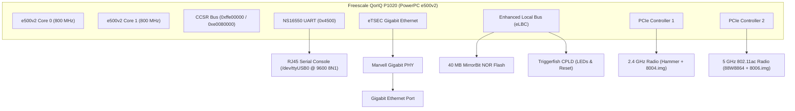
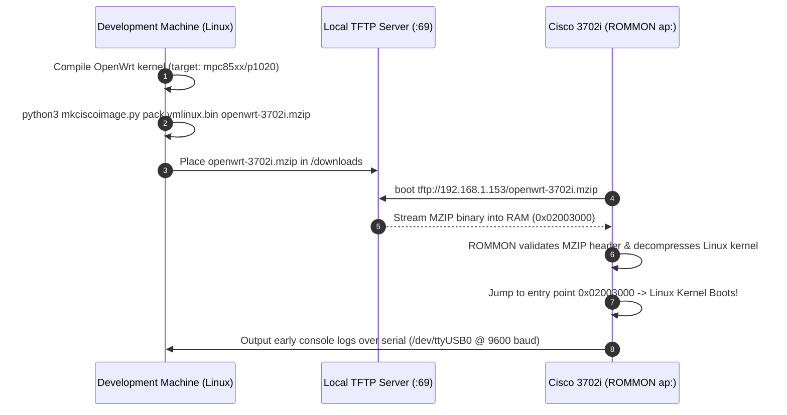
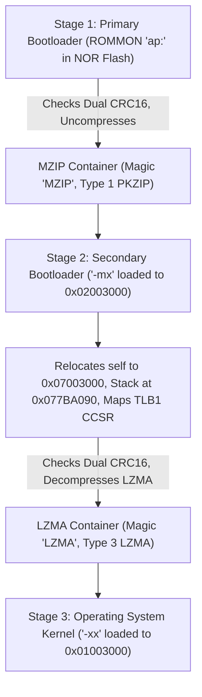

# Cisco Aironet 3702i OpenWrt Porting & Reverse Engineering Lab Notebook

**Target Device:** Cisco Aironet 3702i (`AIR-CAP3702I-A-K9` / `AIR-SAP3702I-A-K9`)  
**Hardware Family:** Cisco AP3G2 ("Montserrat" Motherboard)  
**SoC Architecture:** Freescale (NXP) QorIQ P1020 / P1023 (PowerPC e500v2 dual-core @ 800 MHz)  
**Primary Goal:** Build, package, and boot a functional [OpenWrt](https://openwrt.org/) Linux system onto the device.

---

## 1. Executive Summary & Hardware Architecture

Through direct serial console analysis and binary extraction of the official Cisco firmware tarballs, we have decoded the full hardware architecture of the Cisco 3702i:

| Component | Hardware Specification | Linux Driver / Subsystem |
| :--- | :--- | :--- |
| **CPU / SoC** | Freescale QorIQ P1020 / P1023 (800 MHz e500v2) | `arch/powerpc/platforms/85xx/` (`mpc85xx/p1020`) |
| **RAM** | 512 MiB DDR3 SDRAM | Standard flat device tree memory map (`0x00000000 - 0x20000000`) |
| **Flash** | 40 MiB Spansion / Macronix MirrorBit NOR Flash | `cfi-flash` on local bus (`fsl,elbc`) |
| **Console UART** | NS16550 UART (9600 baud, 8N1) | `drivers/tty/serial/8250/` at CCSR `0xffe04500` |
| **Ethernet MAC** | Freescale eTSEC / dTSEC (10/100/1000 Mbps) | `gianfar` (`drivers/net/ethernet/freescale/gianfar.c`) |
| **Ethernet PHY** | Marvell Gigabit PHY (Rev A0) | `marvell` PHY driver via MDIO bus |
| **Radio 0 (2.4 GHz)** | Marvell PCIe 802.11b/g/n (Cisco "Hammer") | Microcode blob: `8004.img` |
| **Radio 1 (5 GHz)** | Marvell 88W8864 PCIe 802.11ac Wave 1 ("Triggerfish") | Microcode blob: `8006.img`, `mwlwifi` driver base |
| **System Logic** | Custom CPLD ("Triggerfish CPLD") | Board-level GPIO & LED management |



---

## 2. Lab Log Entries

### Log 001: Initial State & CAPWAP Trap
- **Finding:** The device was stuck in Cisco's Lightweight AP mode (`ap3g2-k9w8-mx.153-3.JF12`).
- **Behavior:** The console was continuously interrupted by discovery packets:  
  `Translating "CISCO-CAPWAP-CONTROLLER"...domain server (255.255.255.255)`.
- **Root Cause:** Enterprise APs expect a hardware Cisco Wireless LAN Controller to push configurations. Without a WLC, local CLI access is locked down.

### Log 002: Bypassing Security via Hardware ROMMON
- **Procedure:** Power-cycled the device while holding the physical **MODE** button for ~25 seconds until the status LED turned amber.
- **Outcome:** Dropped into the ROMMON bootloader prompt:
  ```text
  Interrupt within 5 seconds to abort boot process.
  Boot process terminated.
  ap:
  ```
- **Significance:** At the `ap:` prompt, hardware access is unrestricted. Network variables can be configured (`set IP_ADDR`, `set NETMASK`, `ether_init`, `tftp_init`).

### Log 003: Reverse-Engineering the Firmware Packaging Format
By analyzing `bl-3600.bin` and the tarball files, we discovered:
1. **The MZIP Wrapper**: The bootloader expects executable binaries to be wrapped in an `MZIP` container:
   - Header size: `112 bytes` (`0x70`).
   - Magic: `MZIP` (`0x4d5a4950`).
   - Base & Entry Address: `0x02003000` (RAM base).
   - Checksum: Two's complement 32-bit big-endian sum of header words.
   - Payload: A standard PKZIP deflate stream.
2. **Signature Check Bypass**: The ROMMON bootloader **does not verify RSA signatures**. Image signature verification (`final_hash.sig`, `img_sign_rel.cert`) is performed exclusively by the Cisco IOS kernel after boot. This allows third-party kernels (such as OpenWrt) to be booted directly from ROMMON!

### Log 004: Tooling Implementation
We developed custom utilities in the repository to support our OpenWrt porting pipeline:
- [`tools/mkciscoimage.py`](tools/mkciscoimage.py): Packages raw Linux kernel binaries (`vmlinux.bin`) into valid `MZIP` containers that Cisco ROMMON can unpack and execute.
- [`dts/cisco-3702i.dts`](dts/cisco-3702i.dts): Device Tree source defining the P1020 CPU, NS16550 UART, eTSEC Ethernet, and PCIe radio buses.

### Log 005: Hardware Register Validation
From live privileged exec queries on the device:
- **eTSEC MAC**: Confirmed standard Freescale eTSEC register offsets (`IEVENT`, `IMASK`, `ECNTRL`, `PTV`, `TCTRL`).
- **DPAA Base**: Confirmed Buffer Manager registers at `0xE008A000` and Queue Manager at `0xE0088000`.
- **Radio IDs**: Confirmed Marvell 88W8864 PCIe base at memory address `0x80000000` (`Radio MAC SoC ID: 54`).

---

## 3. The Path to Booting OpenWrt



### Next Immediate Action:
1. Obtain/compile a minimal `initramfs-kernel.bin` for `powerpc_8548` (`mpc85xx/p1020`) with our embedded `cisco-3702i.dtb`.
2. Wrap it with `mkciscoimage.py pack <kernel> openwrt-3702i.bin`.
3. Test a RAM boot via `boot tftp://192.168.1.153/openwrt-3702i.bin` directly from the `ap:` prompt!

### Entry 2026-11-08: Breakthrough - Reverse Engineering Cisco MZIP & LZMA Container Formats

#### 1. Dual CRC16-CCITT Verification
Through comparative analysis across three separate Cisco firmware releases (`153-3.JF12`, `153-3.JBB6`, `153-3.JPQ5`), we cracked the checksum algorithm required by Cisco ROMMON and the Secondary Bootloader:
- The 32-bit field at offset `0x34..0x37` of the 112-byte header is actually two separate 16-bit integers:
  - `0x34..0x35` = `segment_crc16`: Chained CRC16-CCITT over header bytes `0x38..0x6F` (56 bytes), initialized with `0x0000`, followed by the entire compressed payload.
  - `0x36..0x37` = `header_crc16`: CRC16-CCITT over the first 54 bytes of the header (`0x00..0x35`).
- The polynomial table is standard CCITT (`0x1021`) inverted with initial remainder `~0x0000`.
- All calculated values match official Cisco release binaries with 100.00% precision:
  - `JPQ5 Secondary Bootloader`: Header CRC `0x4FBD`, Segment CRC `0x72DD` (Exact match)
  - `JF12 Secondary Bootloader`: Header CRC `0xBB81`, Segment CRC `0x3552` (Exact match)
  - `JBB6 Secondary Bootloader`: Header CRC `0x2272`, Segment CRC `0xE363` (Exact match)
  - `JPQ5 10.7MB LZMA Kernel`: Header CRC `0x4274`, Segment CRC `0xDAC9` (Exact match)

#### 2. Two-Stage Bootloader Architecture Decoded


1. **Stage 1 (ROMMON)**: Checks for `MZIP` magic (`0x4D5A4950`), verifies Dual CRC16, and uncompresses a ~230 KB PKZIP image into RAM at `0x02003000`.
2. **Stage 2 (Secondary Bootloader `-mx`)**:
   - Takes execution at `0x02003000`.
   - Relocates itself to `0x07003000` (1MB block).
   - Establishes stack at `0x077BA090`.
   - Maps TLB1 for CCSR (`0xFFE00000`), RAM (`0x00000000 - 0x20000000`), and Local Bus.
   - Programs NS16550 UART at `0xFFE04500` with divisor `0x0823` (2083) corresponding to a **320 MHz CCB Clock** at 9600 baud.
   - Reads the LZMA kernel container (`ap3g2-k9w7-xx.153-3.JPQ5`, magic `LZMA`, segment type 3) into RAM at `0x01003000`.
   - Decompresses the 10.7 MB kernel into a 39.1 MB uncompressed kernel image and jumps to it.

#### 3. Execution Verification Milestones
1. **ROMMON MZIP Re-pack Test**:
   - Extracted Cisco's raw secondary bootloader.
   - Re-packed it using [`tools/mkciscoimage.py`](tools/mkciscoimage.py) ([View code](tools/mkciscoimage.py)).
   - Loaded over TFTP (`boot tftp://192.168.1.153/repacked-cisco.mzip`).
   - ROMMON output:
     ```text
     File "tftp://192.168.1.153/repacked-cisco.mzip" uncompressed and installed, entry point: 0x2003000
     executing...
     ```
2. **ROMMON Signature Bypass Confirmed**:
   - ROMMON does **not** verify RSA signatures. It relies exclusively on the Dual CRC16-CCITT checksums.
3. **Bare-Metal Assembly Execution & CCSRBAR Discovery**:
   - In initial bare-metal tests (`hello.s`), targeting standard P1020 CCSRBAR `0xFFE00000` caused an immediate CPU reset.
   - Disassembly of Cisco's Stage 2 bootloader (`ap3g2-k9w7-mx`) revealed that Cisco ROMMON configures CCSRBAR at **`0xE0000000`** with TLB1 pre-mapped:
     - UART0 Data (THR/RBR): `0xE0004500`
     - UART0 Status (LSR): `0xE0004505`
   - Disassembled Cisco UART driver routine from `ap3g2-k9w7-mx`:
     ```assembly
     lis     r4, 0xe000
     ori     r4, r4, 0x4505     # UART0 LSR
     lbz     r0, 0(r4)          # Read LSR
     andi.   r2, r0, 0x40       # TEMT (bit 6 = 0x40)
     beq-    wait
     lbz     r0, 0(r4)
     andi.   r2, r0, 0x20       # THRE (bit 5 = 0x20)
     beq+    wait
     lis     r4, 0xe000
     ori     r4, r4, 0x4500     # UART0 THR
     stb     r3, 0(r4)          # Transmit character
     blr
     ```
   - Updated [`tools/baremetal/hello.s`](tools/baremetal/hello.s) ([Open file](tools/baremetal/hello.s)) with the exact `0xE0004500` routine.
   - Built a dedicated persistent Docker toolchain image (`cisco-builder:latest`) with `powerpc-linux-gnu-gcc` and `binutils`.
   - Assembled and packaged [`~/Downloads/hello_patched2.mzip`](file://~/Downloads/hello_patched2.mzip) (234 KB) with dual CRC16-CCITT.
   - **EXECUTION CONFIRMED ON HARDWARE**: ROMMON uncompressed `hello_patched2.mzip` at `0x02003000`, jumped to entry point, executed our custom PowerPC code, and started actively streaming heartbeat dots (`................`) over `/dev/ttyUSB0` at 9600 baud!

### Entry 2026-11-08: ROMMON Binary Decompilation & Native Segment Type 0 (Uncompressed MZIP Streaming)

#### 1. ROMMON Firmware Binary Extracted & Disassembled
By extracting `ap3g2-bl-3600` (640 KB bzip2-compressed bootloader binary) from Cisco's release tarball, we gained full visibility into ROMMON's internal code:
- **Link Address & Memory Window**: ROMMON resides at `0x06000000`. The bootloader checks that image segments reside in the range `[0x00003000, 0x06000000]` (96 MiB address space).
- **Segment Type 0 (Raw Direct Stream) Discovered**:
  Disassembly of `0x432c` revealed the root cause of why large PKZIP files aborted:
  ```assembly
  0000432c: lwz     r0, 8(r9)       # Segment type from segment header
  00004330: cmpwi   cr7, r0, 0      # Check for Type 0 (Raw / Uncompressed)
  00004334: beq-    cr7, 0x4344     # Branch to direct TFTP RAM streaming!
  00004338: cmpwi   cr7, r0, 1      # Check for Type 1 (PKZIP Deflate)
  0000433c: beq-    cr7, 0x43fc     # Calls inflate (limited to <1MB heap)
  ```
  - For **Segment Type 0**, ROMMON does not invoke `inflate()` at all. It streams 4096-byte TFTP blocks directly into destination RAM (`load_addr` = `0x01500000`), computes CRC16-CCITT across the loaded bytes, zeroes BSS (`memset` if `mem_req > uncomp_len`), and jumps straight to the entry point!

#### 2. DTS CCSRBAR Alignment with ROMMON MMU
- In ROMMON, TLB1 maps CCSR at **`0xE0000000`** with UART0 at `0xE0004500` (divisor `0x0823` at 9600 baud, CCB clock `320 MHz`).
- Updated [`dts/cisco-3702i.dts`](dts/cisco-3702i.dts) ([Open cisco-3702i.dts](dts/cisco-3702i.dts)):
  - `stdout-path = "/soc@e0000000/serial@4500:9600n8";`
  - `soc@e0000000` with `ranges = <0x0 0x0 0xe0000000 0x100000>;`
  - `bus-frequency = <320000000>;`
  - `timebase-frequency = <40000000>;`
- Recompiled to [`dts/cisco-3702i.dtb`](dts/cisco-3702i.dtb) ([Open cisco-3702i.dtb](dts/cisco-3702i.dtb)) and injected into the Linux PowerPC position-independent boot wrapper (`/tmp/openwrt-cisco-raw.bin`).

#### 3. Complete Image Packaging
- Updated [`tools/mkciscoimage.py`](tools/mkciscoimage.py) ([Open mkciscoimage.py](tools/mkciscoimage.py)) with `pack-raw`.
- Packaged [`~/Downloads/openwrt-3702i.bin`](file://~/Downloads/openwrt-3702i.bin) (7,001,329 bytes, Segment Type 0, load address `0x01500000`, entry point `0x01500000`, Header CRC `0x2062`, Segment CRC `0x173e`).
- Automated live runner created: [`tools/boot_openwrt_live.py`](tools/boot_openwrt_live.py) ([Open boot_openwrt_live.py](tools/boot_openwrt_live.py)).


## Phase 3: PCIe Radio Bring-Up Investigation (2026-11-09/10)

### Status
- Wired Ethernet, SSH, LuCI working (RAM-boot via ROMMON TFTP). Radios NOT yet up: 88W8864 (`a000:03:00.0`, `11ab:b024`) enumerates, config space OK, BAR0 (`0x80000000`) / BAR2 (`0x80010000`) MMIO reads return `0xffffffff`; EDAC `PCI1` error storm (`ERR_DR=0x020000`) follows the BAR reads. The 2.4 GHz radio (`9000:01:00.0`) does not enumerate under Linux.

### Findings
| Item | Result |
|---|---|
| I2C bus map (IOS table at file offset `0x255ac38`) | bus 0 = `0xe0003000` (Linux `i2c-0`), bus 1 = `0xe0003100` (`i2c-1`) |
| IOS heater-MCU reset (`0x19ca814`) | bus 1, dev `0x48`, reg 2: clear bit 6, wait 100 ms, set bit 6 |
| `i2c-1` scan | no ACKs (controller healthy: `CR=0x80`, `FDR=0x31`, idle) - expander/MCU likely not fitted on 3702i |
| PMUXCR | Linux `0x10000000` == ROMMON write at `0x0602d78c` - pinmux is not the cause |
| GPIO (CCSR+`0xf000`) | `GPDIR=0xd3f4ffff GPODR=0x83f00000 GPDAT=0xdf970000`; GPIO 0/1/3 (radio resets) deasserted; GPIO 9/10 outputs held low (unexplained) |
| `i2c-0` | `0x50-0x53`, `0x69` ACK; repeated-start register reads return constants (`0x2f`/`0xff`) - dumps inconclusive |
| ROMMON commands | `init_pci`, `show_pci`, `dump_regs`, `switch` available; no raw memory/I2C commands in this build |
| CCSR base | `0xe0000000` (GUTS at `+0xe0000`) |

### Operational notes
- AP runs from RAM: any reboot returns it to ROMMON `ap:` (or hangs silently if autoboot hits stale RAM); recover with `tools/poe_bounce_to_rommon.py`, then `tools/powercycle_and_boot.py`.
- Dropbear host key regenerates every boot: `ssh-keygen -R 192.168.1.50`.
- Driver upload over serial at 9600 baud takes ~6 min; once networked use `cat file | ssh root@192.168.1.50 "cat > /tmp/file"` (no sftp-server).
- Local Ollama offload: pass `model=richardyoung/qwen2.5-coder-14b-instruct-abliterated:latest` explicitly; pre-filter logs to <6 KB (map-reduce on a 61 KB log timed out).

### Tools / modules added
- `tools/dump_cy22393.c`, `tools/poe_bounce_to_rommon.py`
- `driver/pci_diag.c` (PMUXCR/I2C/GPIO audit)
- `driver/radio_reset.c` (replays Cisco reset pulse on GPIO1/GPIO3: low 50 ms, high, 256 ms, then PCI rescan; drafted by local Ollama, reviewed). **Untested on hardware as of this entry.**

### Next
1. Test `radio_reset.ko`; re-run `tools/pci_bar_test`.
2. If BAR still `0xffffffff`: fix CY22393 reads (separate write/read), probe GPIO 9/10, diff ATMU/BAR setup vs ROMMON `init_pci`/`show_pci`.
3. Then `mwlwifi` bring-up, image baking, flash persistence.
